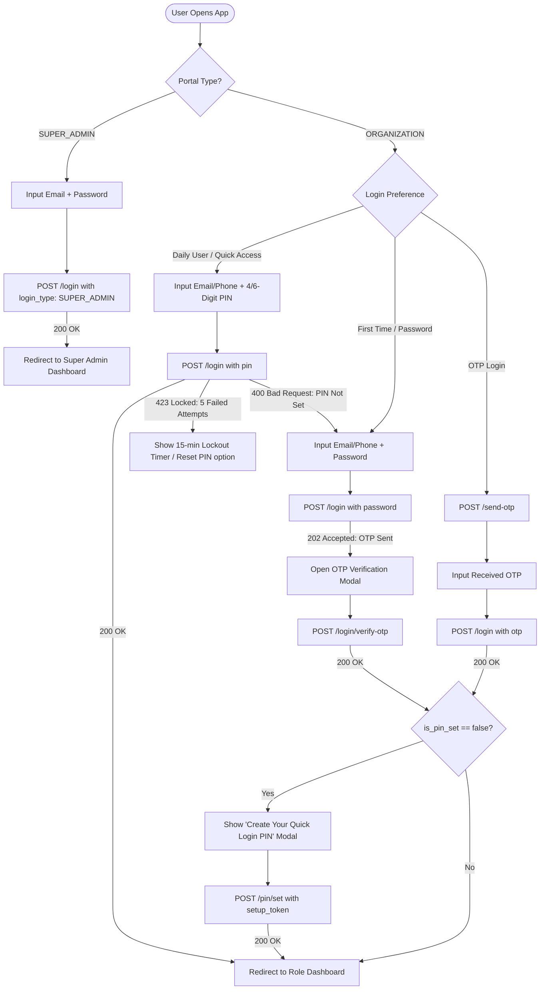
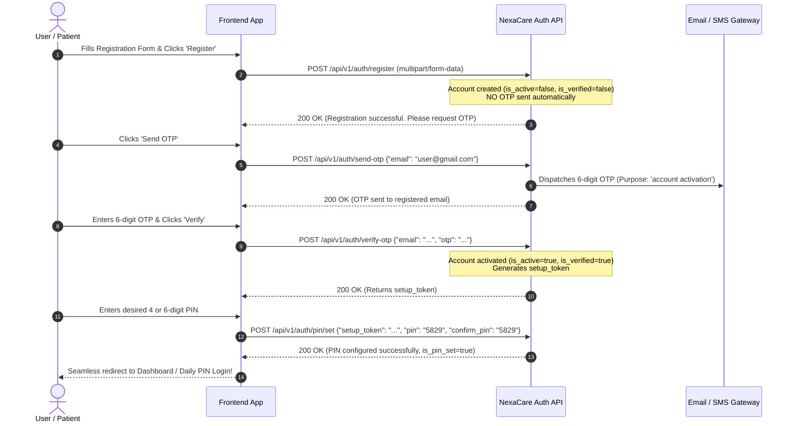

# NexaCare - Frontend Developer Integration Guide
## Complete Authentication, Quick PIN & Session Architecture

> **Target Audience:** Frontend Engineers (Web - React / Next.js / Vue & Mobile - React Native / Flutter)  
> **Base API URL:** `http://<SERVER_HOST>:<PORT>/api/v1/auth`  
> **Backend Specification Version:** v2.1 (Multi-Tenant & PIN Auth Enabled)  
> **Last Updated:** November 2026  

---

## 📑 Table of Contents
1. [Overview & Authentication Concepts](#1-overview--authentication-concepts)
2. [Token Types Explained](#2-token-types-explained)
3. [Decision Flow Diagram (UI Workflow)](#3-decision-flow-diagram-ui-workflow)
4. [Step-by-Step API Endpoints & Request/Response Payloads](#4-step-by-step-api-endpoints--requestresponse-payloads)
   - [A. Super Admin Direct Login](#a-super-admin-direct-login)
   - [B. Quick PIN Login (Staff & Hospital Admins)](#b-quick-pin-login-staff--hospital-admins)
   - [C. Password + OTP Challenge Login (First-time / Recovery)](#c-password--otp-challenge-login-first-time--recovery)
   - [D. Direct Mobile/Email OTP Login](#d-direct-mobileemail-otp-login)
   - [E. PIN Setup (`/pin/set`)](#e-pin-setup-pinset)
   - [F. Authenticated Change PIN (`/pin/change`)](#f-authenticated-change-pin-pinchange)
   - [G. Forgot & Reset PIN Recovery (`/pin/forgot` & `/pin/reset`)](#g-forgot--reset-pin-recovery-pinforgot--pinreset)
5. [Frontend Validation Rules for PIN](#5-frontend-validation-rules-for-pin)
6. [TypeScript Interfaces & Models](#6-typescript-interfaces--models)
7. [Frontend Axios / Fetch Interceptor Guidelines](#7-frontend-axios--fetch-interceptor-guidelines)

---

## 1. Overview & Authentication Concepts

The NexaCare platform uses a unified multi-tenant authentication engine serving three distinct application contexts via `login_type`:

| `login_type` | Targeted Portals | Allowed User Roles |
|---|---|---|
| `SUPER_ADMIN` | Global NexaCare Admin Portal | `Super Admin` |
| `ORGANIZATION` | Hospital Web App, Doctor Tablet App, Nurse Station, Pharmacist, Lab Tech | `Hospital Admin`, `Doctor`, `Nurse`, `Receptionist`, `Accountant`, `Pharmacist`, `Lab Technician` |
| `PATIENT` | Patient Mobile App / Portal | `Patient` |

> ⚠️ **Important Context Rule:**  
> The frontend **must** pass `login_type` in the login request. If a Doctor tries to log in through the Super Admin portal, or a Super Admin tries to log in through the Organization portal, the backend returns **`HTTP 403 Forbidden`**.

---

## 2. Token Types Explained

| Token Name | Token Type in JWT | Lifespan | When is it returned? | Frontend Purpose |
|---|---|---|---|---|
| **`access_token`** | `"type": "access"` | 2 Hours (120 min) | Every successful login | Send in `Authorization: Bearer <access_token>` for all protected API calls. |
| **`refresh_token`** | `"type": "refresh"` | 7 Days | Every successful login | Store in secure storage / HTTP-only cookie. Used at `/auth/refresh-token` to silently get a new access token. |
| **`challenge_token`** | `"type": "login_otp_challenge"` | 5 Minutes | During Password login (HTTP 202) | Sent back to `/login/verify-otp` with the OTP received on email. Single-use only. |
| **`setup_token`** | `"type": "pin_setup"` | 15 Minutes | On login when `is_pin_set == false` | Sent to `/auth/pin/set` to configure the user's PIN without requiring manual Bearer header. |

---

## 3. Decision Flow Diagram (UI Workflow)



---

## 4. Step-by-Step API Endpoints & Request/Response Payloads

---

### 0. User Registration & Activation Flow (Mandatory 4-Step Lifecycle)
To ensure reliable delivery and avoid SMTP blocking during registration, registration creates the account without auto-dispatching OTP. The user explicitly requests OTP, verifies it to activate, and creates their PIN.



#### Step 1: Account Registration
* **Endpoint:** `POST /api/v1/auth/register`
* **Request Content-Type:** `multipart/form-data`
* **Form Fields:** `email`, `password`, `full_name`, `phone`, `role_name`, `gender`, `date_of_birth`, etc.
* **Success Response (`HTTP 200 OK`):**
```json
{
  "success": true,
  "message": "Registration successful. Please request OTP to verify and activate your account.",
  "data": {
    "message": "Registration successful. Please request OTP to verify and activate your account."
  }
}
```

#### Step 2: Request OTP
* **Endpoint:** `POST /api/v1/auth/send-otp`
* **Request Content-Type:** `application/json`
* **Request Body:**
```json
{
  "email": "user@gmail.com"
}
```
* **Success Response (`HTTP 200 OK`):**
```json
{
  "success": true,
  "message": "OTP sent",
  "data": {
    "message": "OTP sent to your registered email u***r@gmail.com",
    "masked_email": "u***r@gmail.com"
  }
}
```

#### Step 3: Verify OTP & Activate Account
* **Endpoint:** `POST /api/v1/auth/verify-otp` (or `POST /api/v1/auth/activate`)
* **Request Content-Type:** `application/json`
* **Request Body:**
```json
{
  "email": "user@gmail.com",
  "otp": "123456"
}
```
* **Success Response (`HTTP 200 OK`):**
```json
{
  "success": true,
  "message": "OTP verified",
  "data": {
    "message": "OTP verified successfully",
    "setup_token": "eyJhbGciOiJIUzI1NiIsInR5cCI6InBpbl9zZXR1cCI...",
    "is_active": true,
    "is_verified": true
  }
}
```
> 💡 **Frontend Tip:** Take the `setup_token` from this response and immediately navigate the user to the "Create Your Quick Login PIN" screen!

#### Step 4: Configure Quick PIN
* **Endpoint:** `POST /api/v1/auth/pin/set`
* **Request Content-Type:** `application/json`
* **Request Body:**
```json
{
  "setup_token": "eyJhbGciOiJIUzI1NiIsInR5cCI6InBpbl9zZXR1cCI...",
  "pin": "5829",
  "confirm_pin": "5829"
}
```
* **Success Response (`HTTP 200 OK`):**
```json
{
  "success": true,
  "message": "PIN configured successfully",
  "data": {
    "is_pin_set": true,
    "message": "PIN configured successfully"
  }
}
```

---

#### 🚫 Unverified Login Restriction
If an unverified or inactive user attempts to call `POST /api/v1/auth/login` (via Password, Mobile+OTP, or PIN):
* **Response Status:** `HTTP 401 Unauthorized`
* **Response Body:**
```json
{
  "detail": "Account not verified. Please verify OTP first before logging in."
}
```
* **Frontend Handling:** Intercept this error message and present the user with a direct button: `[ Verify OTP Now ]` which redirects them to Step 2/Step 3.

---

### A. Super Admin Direct Login
Super Admin accounts have global access and **bypass OTP/PIN challenges**. They receive `HTTP 200` directly with full access tokens.

* **Endpoint:** `POST /api/v1/auth/login`
* **Request Headers:** `Content-Type: application/json`
* **Request Body:**
```json
{
  "email": "admin@nesacare1234.com",
  "password": "your_secure_password",
  "login_type": "SUPER_ADMIN"
}
```
* **Success Response (`HTTP 200 OK`):**
```json
{
  "success": true,
  "message": "Login successful",
  "data": {
    "access_token": "eyJhbGciOiJIUzI1NiIsInR5cCI6IkpXVCJ9...",
    "refresh_token": "eyJhbGciOiJIUzI1NiIsInR5cCI6IkpXVCJ9...",
    "token_type": "bearer",
    "expires_in": 7200,
    "role": "Super Admin",
    "is_pin_set": false,
    "setup_token": null,
    "user": {
      "id": 1,
      "user_code": "USR-SA001",
      "full_name": "System Super Admin",
      "email": "admin@nesacare1234.com",
      "role": "Super Admin",
      "hospital_id": null
    }
  }
}
```

---

### B. Quick PIN Login (Staff & Hospital Admins)
This is the **primary daily login screen** for doctors, nurses, and hospital staff.

* **Endpoint:** `POST /api/v1/auth/login`
* **Request Headers:** `Content-Type: application/json`
* **Request Body:**
```json
{
  "email": "doctor@hospital.com",
  "pin": "2580",
  "login_type": "ORGANIZATION"
}
```
*(You can also pass `"phone": "7719856488"` instead of `"email"`).*

* **Success Response (`HTTP 200 OK`):**
```json
{
  "success": true,
  "message": "Login successful",
  "data": {
    "access_token": "eyJhbGciOiJIUzI1NiIsInR5cCI6IkpXVCJ9...",
    "refresh_token": "eyJhbGciOiJIUzI1NiIsInR5cCI6IkpXVCJ9...",
    "token_type": "bearer",
    "expires_in": 7200,
    "role": "Doctor",
    "is_pin_set": true,
    "user": {
      "id": 13941,
      "full_name": "Dr. Pratik Narkhede",
      "email": "doctor@hospital.com",
      "phone": "+917719856488",
      "role": "Doctor",
      "hospital_id": 2182
    }
  }
}
```

* **Error Responses:**
  * **`HTTP 400 Bad Request`**:  
    `{"detail": "PIN is not configured for this account. Please log in with password or OTP."}`  
    👉 *Frontend Action:* Redirect to Password / OTP login.
  * **`HTTP 401 Unauthorized`**:  
    `{"detail": "Invalid PIN"}`  
    👉 *Frontend Action:* Shake PIN input, show error message, track attempts.
  * **`HTTP 423 Locked`**:  
    `{"detail": "PIN is temporarily locked due to too many failed attempts. Try again later or reset your PIN."}`  
    👉 *Frontend Action:* Lock the PIN keypad, start a 15-minute countdown timer, show a "Forgot / Reset PIN" button.

---

### C. Password + OTP Challenge Login (First-time / Recovery)
When an organization user logs in with password and **does not have a PIN configured yet** (or `require_otp: true` is set):

#### Step 1: Submit Password
* **Endpoint:** `POST /api/v1/auth/login`
* **Request Body:**
```json
{
  "email": "doctor@hospital.com",
  "password": "Password@123",
  "login_type": "ORGANIZATION"
}
```
* **Challenge Response (`HTTP 202 Accepted`):**
```json
{
  "message": "OTP sent to your registered email do****r@hospital.com",
  "data": {
    "challenge_token": "eyJhbGciOiJIUzI1NiIsInR5cCI6ImxvZ2luX290cF9jaGFsbGVuZ2Ui...",
    "masked_email": "do****r@hospital.com",
    "message": "OTP sent to your registered email do****r@hospital.com",
    "require_otp": true,
    "is_pin_set": false
  }
}
```
👉 *Frontend Action:* Save `challenge_token` in memory/state and display an OTP entry modal.

#### Step 2: Verify OTP
* **Endpoint:** `POST /api/v1/auth/login/verify-otp`
* **Request Body:**
```json
{
  "challenge_token": "eyJhbGciOiJIUzI1NiIsInR5cCI6ImxvZ2luX290cF9jaGFsbGVuZ2Ui...",
  "otp": "482910"
}
```
* **Success Response (`HTTP 200 OK`):**
```json
{
  "success": true,
  "message": "Login successful",
  "data": {
    "access_token": "eyJhbGciOi...",
    "refresh_token": "eyJhbGciOi...",
    "is_pin_set": false,
    "setup_token": "eyJhbGciOiJIUzI1NiIsInR5cCI6InBpbl9zZXR1cCIs...",
    "role": "Doctor",
    "user": { ... }
  }
}
```
👉 *Frontend Action:* Store `access_token` and `refresh_token`. Since `is_pin_set == false`, immediately open the **"Create Your 4-Digit Quick PIN"** modal with `setup_token`.

---

### D. Direct Mobile/Email OTP Login
Passwordless login option using Email or Indian Phone Number (+91 format or 10-digit).

#### Step 1: Request OTP
* **Endpoint:** `POST /api/v1/auth/send-otp`
* **Request Body:**
```json
{
  "email": "doctor@hospital.com"
}
```
*(Or `{"phone": "7719856488"}`)*

* **Response (`HTTP 200 OK`):**
```json
{
  "success": true,
  "message": "OTP sent",
  "data": {
    "message": "OTP sent to your registered email do****r@hospital.com",
    "masked_email": "do****r@hospital.com"
  }
}
```

#### Step 2: Login with OTP
* **Endpoint:** `POST /api/v1/auth/login`
* **Request Body:**
```json
{
  "phone": "7719856488",
  "otp": "482910",
  "login_type": "ORGANIZATION"
}
```
* **Success Response (`HTTP 200 OK`):**
```json
{
  "success": true,
  "message": "Login successful",
  "data": {
    "access_token": "eyJhbGciOi...",
    "refresh_token": "eyJhbGciOi...",
    "is_pin_set": false,
    "setup_token": "eyJhbGciOiJIUzI1NiIsInR5cCI6InBpbl9zZXR1cCI...",
    "role": "Doctor",
    "user": { ... }
  }
}
```
👉 *Notice:* `setup_token` is automatically provided whenever `is_pin_set == false`!

---

### E. PIN Setup (`/pin/set`)
Used to configure the user's PIN for the very first time. Can be authenticated in **two flexible ways**:

* **Endpoint:** `POST /api/v1/auth/pin/set`
* **Method 1 (Recommended - using `setup_token`):**
  * **Headers:** `Content-Type: application/json`
  * **Payload:**
    ```json
    {
      "pin": "1122",
      "confirm_pin": "1122",
      "setup_token": "<setup_token_or_access_token_from_login>"
    }
    ```
* **Method 2 (Using Bearer Token header):**
  * **Headers:** 
    * `Content-Type: application/json`
    * `Authorization: Bearer <access_token>`
  * **Payload:**
    ```json
    {
      "pin": "1122",
      "confirm_pin": "1122"
    }
    ```

* **Success Response (`HTTP 200 OK`):**
```json
{
  "success": true,
  "message": "PIN configured successfully",
  "data": {
    "is_pin_set": true,
    "message": "PIN configured successfully"
  }
}
```
👉 *Frontend Action:* Update user state `is_pin_set = true`, close modal, toast success: *"Quick Login PIN created successfully!"*.

---

### F. Authenticated Change PIN (`/pin/change`)
Used inside the app's Profile / Settings screen when a logged-in user wants to change their PIN.

* **Endpoint:** `PUT /api/v1/auth/pin/change`
* **Headers:** 
  * `Content-Type: application/json`
  * `Authorization: Bearer <access_token>`
* **Request Body:**
```json
{
  "current_pin": "1122",
  "new_pin": "2580",
  "confirm_pin": "2580"
}
```
* **Success Response (`HTTP 200 OK`):**
```json
{
  "success": true,
  "message": "PIN changed successfully",
  "data": {
    "is_pin_set": true,
    "message": "PIN changed successfully"
  }
}
```
* **Validation Errors (`HTTP 401 / 422`):**
  * `401 Unauthorized`: `"Current PIN is incorrect"`
  * `422 Unprocessable Entity`: `"New PIN cannot be the same as current PIN"`
  * `422 Unprocessable Entity`: `"New PIN and confirmation PIN do not match"`

---

### G. Forgot & Reset PIN Recovery (`/pin/forgot` & `/pin/reset`)
If a user forgets their PIN or their PIN is locked due to 5 failed attempts:

#### Step 1: Request Reset OTP
* **Endpoint:** `POST /api/v1/auth/pin/forgot`
* **Request Body:**
```json
{
  "email": "doctor@hospital.com"
}
```
* **Response (`HTTP 200 OK`):**
```json
{
  "success": true,
  "message": "OTP sent",
  "data": {
    "message": "OTP sent to your registered email do****r@hospital.com for PIN reset",
    "masked_email": "do****r@hospital.com"
  }
}
```

#### Step 2: Verify OTP and Set New PIN
* **Endpoint:** `POST /api/v1/auth/pin/reset`
* **Request Body:**
```json
{
  "email": "doctor@hospital.com",
  "otp": "592104",
  "new_pin": "9517",
  "confirm_pin": "9517"
}
```
* **Success Response (`HTTP 200 OK`):**
```json
{
  "success": true,
  "message": "PIN reset successfully. You can now login with your new PIN.",
  "data": {
    "message": "PIN reset successfully. You can now login with your new PIN."
  }
}
```
👉 *Frontend Action:* Clears any active lockout, redirects to Quick PIN login screen.

---

## 5. Frontend Validation Rules for PIN

To prevent unnecessary API roundtrips and provide real-time UI feedback, the frontend form should implement the following checks:

| Validation Rule | Explanation | Error Message to show user |
|---|---|---|
| **Exact Length** | Must be exactly **4 digits or 6 digits**. | *"PIN must be exactly 4 or 6 numeric digits"* |
| **Numeric Only** | Only digits `0-9` are permitted. | *"PIN can only contain numbers"* |
| **Identical Digits** | Cannot be all same digit (e.g., `0000`, `1111`, `999999`). | *"PIN cannot consist of identical digits (e.g. 0000)"* |
| **Consecutive Sequence** | Cannot be ascending/descending sequence (e.g., `1234`, `4321`, `123456`, `654321`). | *"PIN cannot be a consecutive sequence (e.g. 1234)"* |
| **Confirmation Match** | `pin === confirm_pin`. | *"PIN and Confirm PIN must match"* |

### 💡 Example Client-side Validator (JavaScript / TypeScript):
```typescript
export function validatePinInput(pin: string, confirmPin?: string): string | null {
  const trimmed = pin.trim();
  if (!/^\d{4}$|^\d{6}$/.test(trimmed)) {
    return "PIN must be exactly 4 or 6 digits.";
  }
  // Check identical digits (e.g., "1111")
  if (new Set(trimmed).size === 1) {
    return "PIN cannot consist of identical digits (e.g. 1111).";
  }
  // Check sequential sequences
  const sequences = new Set([
    "0123", "1234", "2345", "3456", "4567", "5678", "6789",
    "9876", "8765", "7654", "6543", "5432", "4321", "3210",
    "012345", "123456", "234567", "345678", "456789",
    "987654", "876543", "765432", "654321", "543210"
  ]);
  if (sequences.has(trimmed)) {
    return "PIN cannot be an easy sequence (e.g. 1234).";
  }
  if (confirmPin !== undefined && trimmed !== confirmPin.trim()) {
    return "PIN and confirmation PIN do not match.";
  }
  return null; // Valid!
}
```

---

## 6. TypeScript Interfaces & Models

Frontend teams can copy-paste these interfaces into their project (e.g. `src/types/auth.ts`):

```typescript
export type LoginContext = 'SUPER_ADMIN' | 'ORGANIZATION' | 'PATIENT';

export interface UserProfile {
  id: number;
  user_code: string;
  full_name: string;
  email: string;
  phone?: string | null;
  role_id: number;
  role_name: string;
  role: string;
  hospital_id?: number | null;
  profile_image?: string | null;
  gender?: string | null;
  date_of_birth?: string | null;
  is_active: boolean;
  is_verified: boolean;
  is_pin_set: boolean;
  last_login?: string | null;
}

export interface TokenResponse {
  access_token: string;
  refresh_token: string;
  token_type: 'bearer';
  expires_in: number;
  role: string;
  is_pin_set: boolean;
  setup_token?: string | null;
  user: UserProfile;
}

export interface LoginOTPChallengeResponse {
  challenge_token: string;
  masked_email?: string;
  message: string;
  require_otp: boolean;
  is_pin_set: boolean;
}

export interface SetPINPayload {
  pin: string;
  confirm_pin: string;
  setup_token?: string | null;
}

export interface ChangePINPayload {
  current_pin: string;
  new_pin: string;
  confirm_pin: string;
}

export interface ResetPINPayload {
  email?: string;
  phone?: string;
  otp: string;
  new_pin: string;
  confirm_pin: string;
}
```

---

## 7. Frontend Axios / Fetch Interceptor Guidelines

### 1. Attaching Access Token
Always check and attach the active `access_token` in headers:
```typescript
apiClient.interceptors.request.use((config) => {
  const token = localStorage.getItem('access_token');
  if (token && !config.headers.Authorization) {
    config.headers.Authorization = `Bearer ${token}`;
  }
  return config;
});
```

### 2. Silent Token Refresh on 401
When an `access_token` expires (after 2 hours), intercept `401 Unauthorized` and exchange `refresh_token`:
```typescript
apiClient.interceptors.response.use(
  (response) => response,
  async (error) => {
    const originalRequest = error.config;
    if (error.response?.status === 401 && !originalRequest._retry) {
      originalRequest._retry = true;
      const refreshToken = localStorage.getItem('refresh_token');
      if (refreshToken) {
        try {
          const res = await axios.post('/api/v1/auth/refresh-token', {
            refresh_token: refreshToken,
          });
          const { access_token, refresh_token: newRefresh } = res.data.data;
          localStorage.setItem('access_token', access_token);
          if (newRefresh) localStorage.setItem('refresh_token', newRefresh);
          originalRequest.headers.Authorization = `Bearer ${access_token}`;
          return apiClient(originalRequest);
        } catch (refreshErr) {
          // Token expired or revoked: clear session and redirect to login
          localStorage.clear();
          window.location.href = '/login';
        }
      }
    }
    return Promise.reject(error);
  }
);
```

---

## 8. Summary Checklist for Frontend Developers

- [ ] Ensure all login requests pass the correct `login_type` (`SUPER_ADMIN`, `ORGANIZATION`, `PATIENT`).
- [ ] Render a quick 4/6-digit numeric keypad / input screen for daily logins (`POST /auth/login` with `pin`).
- [ ] If `POST /auth/login` returns `HTTP 202`, open the OTP Challenge modal with `challenge_token`.
- [ ] If `is_pin_set === false` in any successful login response, open the **"Set Your Quick PIN"** modal with `data.setup_token`.
- [ ] Add client-side PIN validation (length 4 or 6, not sequence, not identical digits).
- [ ] Handle `HTTP 423 Locked` by showing the 15-minute lockout timer and the "Forgot PIN" recovery link.

