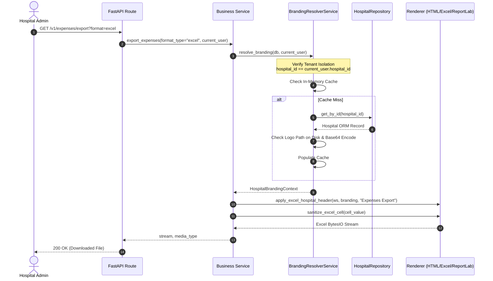
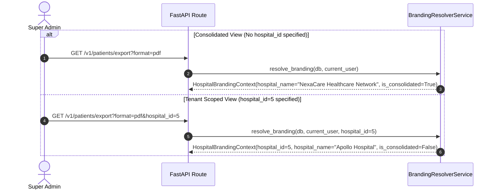
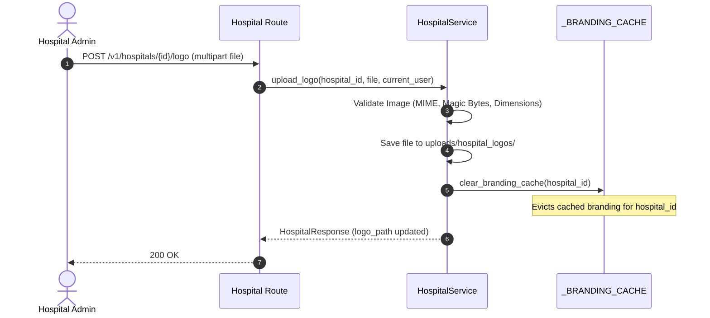

# NexaCare Hospital Management SaaS — Centralized Hospital Branding Architecture

---

## 1. Architectural Principles

NexaCare is a multi-tenant Hospital Management System (SaaS). The centralized branding architecture satisfies the following core requirements:

1. **Strict Multi-Tenant Isolation**: Hospital Admins, Doctors, and Staff are strictly restricted to their own hospital's branding. Attempting to query or spoof another hospital's ID immediately raises a `403 ForbiddenException`.
2. **Super Admin Flexibility**: Super Admins can either view consolidated network branding (`NexaCare Healthcare Network`) when accessing cross-hospital data, or pass an explicit hospital ID to inspect tenant-specific document identity.
3. **Engine-Agnostic Asset Resolution**: Document generators in NexaCare use two distinct rendering pipelines:
   - **HTML / Chromium (Playwright)**: Requires Base64 Data URIs (`data:image/png;base64,...`) to avoid sandbox file:// load restrictions.
   - **ReportLab Platypus**: Requires absolute, verified OS filesystem paths (`C:/.../logo.png`) or PIL Image instances.
   The context object (`HospitalBrandingContext`) encapsulates both formats seamlessly.
4. **Zero-Overhead In-Memory Caching**: Resolving hospital branding requires disk I/O to check logos and base64-encode image files. An in-memory TTL cache (`_BRANDING_CACHE`) with invalidation hooks eliminates repeated disk reads during bulk exports.
5. **Universal Fallback Chain**: If a hospital has not uploaded a logo or its path is invalid, the system automatically falls back to `app/static/images/logo.png` rather than failing or omitting the logo.

---

## 2. Core Components

### 2.1 `HospitalBrandingContext`
Defined in `app/services/branding_resolver_service.py`:

```python
@dataclass
class HospitalBrandingContext:
    hospital_id: Optional[int] = None
    hospital_name: str = "NexaCare Hospital"
    hospital_address: Optional[str] = None
    hospital_phone: Optional[str] = None
    hospital_email: Optional[str] = None
    hospital_website: Optional[str] = None
    logo_path: Optional[str] = None          # Absolute OS path to image file (for ReportLab)
    logo_base64: Optional[str] = None        # Raw base64 string
    logo_data_uri: Optional[str] = None      # Ready-to-use data:image/...;base64 URI (for HTML)
    is_platform_branding: bool = False       # True if consolidated or default NexaCare identity
    report_title_prefix: str = ""            # Contextual title prefix
    contact_line: str = ""                   # Formatted single-line contact info for banners

    # Compatibility Aliases
    logo_file_path: Optional[str] = None
    is_consolidated: Optional[bool] = None
```

### 2.2 `BrandingResolverService`
Centralized service with `@classmethod async def resolve_branding(cls, db, current_user, hospital_id=None, x_hospital_id=None)`:
- Enforces role-based tenant access control.
- Resolves tenant ID against `current_user.hospital_id`.
- Checks in-memory TTL cache.
- Queries `HospitalRepository` for hospital metadata.
- Resolves logo candidates on disk and generates Base64 data URIs.
- Returns verified `HospitalBrandingContext`.

### 2.3 Cache Invalidation
Hooked into `HospitalService.upload_logo()`:
```python
clear_branding_cache(hospital.id)
```
Ensures that new logo uploads immediately reflect across all exports and reports without server restart.

---

## 3. Sequence Diagrams

### 3.1 Hospital Admin Document Generation Flow



### 3.2 Super Admin Consolidated vs Scoped Flow



### 3.3 Hospital Logo Upload & Cache Invalidation



---

## 4. Jinja2 Partial Header/Footer Architecture

All HTML export templates now standardize on two reusable partials located in `app/templates/partials/`:

### `brand_header.html`
- Uses `logo_data_uri` with fallback to `logo_base64`.
- Displays dynamic `hospital_name`, `hospital_address`, `hospital_phone`, `hospital_email`, `hospital_website`.
- Right-aligned document metadata: Title, Record Count, Period label, Generation timestamp.
- Consistent corporate navy divider line (`#1e40af`).

### `brand_footer.html`
- Dynamic copyright with `current_year` and `hospital_name`.
- Confidentiality notice and disclaimer.
- Clean divider line.

---

## 5. ReportLab Platypus Architecture

ReportLab PDF generation relies on `app/utils/reportlab_branding.py`:
- `create_reportlab_header_flowables()`: Creates a Platypus table with logo image, dynamic hospital contact, right-aligned report metadata, and HR line.
- `NumberedCanvas`: Two-pass canvas that accumulates total page count and renders:
  ```
  Left: {hospital_name} • Confidential Document
  Right: Page X of Y
  ```
  guaranteeing exact total page calculations.
